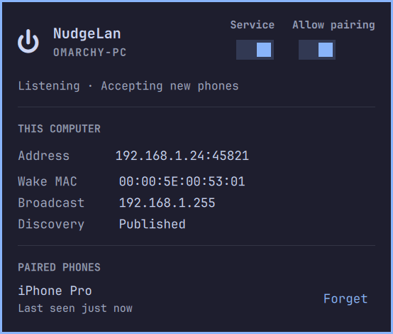
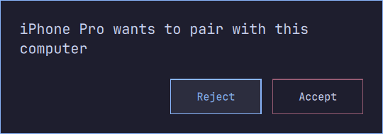
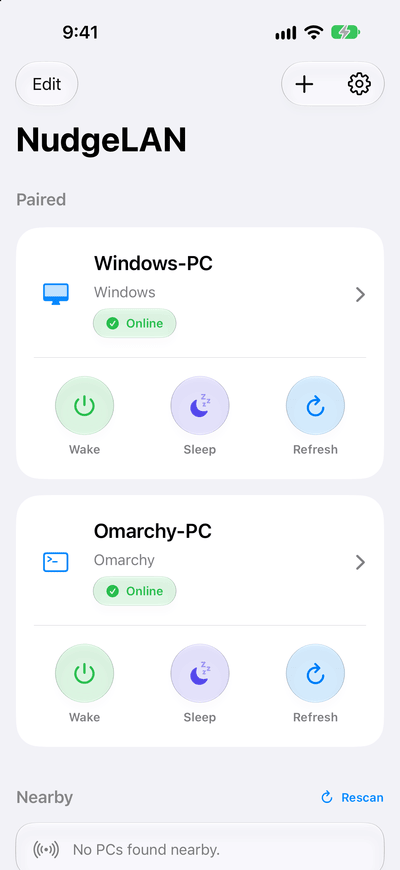

<p align="center">
  <picture>
    <source media="(prefers-color-scheme: dark)" srcset="docs/images/app-icon-dark.png">
    
  </picture>
</p>

<h1 align="center">NudgeLAN for&nbsp;Omarchy</h1>

<p align="center">Wake, sleep, restart, shut down, or lock your Omarchy PC from your iPhone, iPad, or Apple Watch.</p>

NudgeLAN on the iPhone, iPad, and Apple Watch is on the [App Store](https://apps.apple.com/us/app/nudgelan/id6769118183). The Windows companion is on the [Microsoft Store](https://apps.microsoft.com/detail/9nlq8wmg3wcb). The product page is [nudgelan.mariusfanu.com](https://nudgelan.mariusfanu.com).

Binary releases of the NudgeLAN Linux companion for Omarchy.

This repository publishes the release tarball and the package recipe. The application source stays in the private repository. The current release is the [latest release](https://github.com/mariusfanu/nudgelan-agent-bin/releases/latest).

## Screenshots

Omarchy bar panel and pairing prompt. The iPhone list follows light or dark appearance. Screenshots use demo data.

<p align="center">
  
</p>

<p align="center">
  
</p>

<p align="center">
  <picture>
    <source media="(prefers-color-scheme: dark)" srcset="docs/images/list-dark.png">
    
  </picture>
</p>

## Install

Log into the Omarchy desktop and run:

```bash
bash <(curl -fsSL https://github.com/mariusfanu/nudgelan-agent-bin/releases/latest/download/install.sh)
```

The script asks for your password once. It installs the build tools, downloads the package, starts the agent, opens the command port, and puts the NudgeLAN pill on the right side of the bar. Pair from the iPhone.

Running the same command again updates an existing install.

## Remove

```bash
bash <(curl -fsSL https://github.com/mariusfanu/nudgelan-agent-bin/releases/latest/download/uninstall.sh)
```

This takes the pill off the bar, stops the agent, deletes its settings and paired phones, and removes the package. Quickshell stays.
